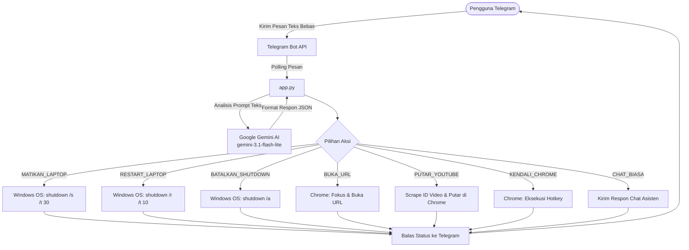

# 🤖 Windows Remote Automation Bot (Telegram + Google Gemini AI)

Sebuah sistem otomatisasi dan pengendali jarak jauh (*remote control*) untuk PC / Laptop berbasis Windows menggunakan **Telegram Bot** dan ditenagai oleh kecerdasan buatan **Google Gemini AI** (`gemini-3.1-flash-lite`).

Bot ini memungkinkan Anda mengontrol Google Chrome, memutar video YouTube otomatis, serta mengelola daya perangkat (shutdown & restart) cukup dengan mengirim pesan teks berbahasa santai/alami di Telegram tanpa perlu menghafal perintah kaku.

---

## 📌 Daftar Isi
- [Fitur Utama](#-fitur-utama)
- [Arsitektur & Alur Kerja](#-arsitektur--alur-kerja)
- [Struktur Proyek](#-struktur-proyek)
- [Prasyarat Sistem](#-prasyarat-sistem)
- [Panduan Instalasi & Konfigurasi](#-panduan-instalasi--konfigurasi)
- [Cara Menjalankan Bot](#-cara-menjalankan-bot)
  - [1. Mode Konsol / Terminal (Debugging)](#1-mode-konsol--terminal-debugging)
  - [2. Mode Latar Belakang (Silent / Hidden)](#2-mode-latar-belakang-silent--hidden)
  - [3. Menghentikan Bot](#3-menghentikan-bot)
- [Daftar Perintah & Contoh Interaksi](#-daftar-perintah--contoh-interaksi)
- [Catatan Teknis & Tips Pengoptimalan](#-catatan-teknis--tips-pengoptimalan)
- [Troubleshooting (Tanya Jawab Kendala)](#-troubleshooting-tanya-jawab-kendala)

---

## 🚀 Fitur Utama

- 🧠 **Pemrosesan Bahasa Alami (NLP) dengan Gemini AI**:
  - Menggunakan model `gemini-3.1-flash-lite` dengan format keluaran terstruktur JSON.
  - Memahami maksud kalimat perintah bebas (contoh: *"tontonin video lofi dong"*, *"buka web kompas"*, *"matikan laptop"*).
- 🌐 **Kendali Penuh Google Chrome**:
  - Otomatis memfokuskan jendela Chrome aktif menggunakan Windows API (`user32.dll`).
  - Membuka tautan/URL langsung ke bilah alamat (*address bar*) dengan shortcut `Alt + D`.
  - Kontrol navigasi tab & halaman:
    - Buka Tab Baru (`Ctrl + T`)
    - Tutup Tab Aktif (`Ctrl + W`)
    - Muat Ulang / Refresh Halaman (`F5`)
    - Gulir Halaman ke Atas/Bawah (`PageUp` / `PageDown`)
- 🎬 **Autoplay Langsung YouTube**:
  - Mengambil ID video YouTube teratas secara instan melalui pencarian web tanpa perlu kuota YouTube Data API resmi.
  - Langsung memutar video di Chrome tanpa perlu klik manual hasil pencarian.
- ⚡ **Manajemen Daya Windows**:
  - **Shutdown Otomatis**: Dilengkapi tenggat waktu 30 detik sebelum mati sehingga aman dari ketidaksengajaan.
  - **Restart Otomatis**: Menjalankan restart sistem dalam 10 detik.
  - **Pembatalan Darurat**: Cukup ketik *"batal"* untuk membatalkan proses shutdown/restart (`shutdown /a`).
- 💬 **Mode Percakapan Asisten**:
  - Jika pesan yang dikirim bukan perintah teknis, bot akan menjawab obrolan biasa secara interaktif dan ramah.
- 🛡️ **Sistem Fallback Darurat**:
  - Jika API Gemini mengalami batas kuota atau jaringan terputus, bot tetap dapat mengeksekusi perintah kritis dasar berbasis kata kunci (seperti *mati*, *restart*, *batal*, *buka*).
- 👻 **Eksekusi Latar Belakang (Silent Mode)**:
  - Bot dapat dijalankan di latar belakang tanpa jendela Command Prompt (CMD) yang mengganggu menggunakan script VBScript.

---

## 🔄 Arsitektur & Alur Kerja



---

## 📁 Struktur Proyek

Berikut adalah berkas-berkas utama di dalam repositori ini:

| Berkas | Deskripsi |
| :--- | :--- |
| `app.py` | Program utama berbasis Python yang mengintegrasikan TeleBot, Google GenAI SDK, manipulasi GUI (`pyautogui`), dan perintah Windows. |
| `requirements.txt` | Daftar pustaka Python pihak ketiga yang dibutuhkan untuk menjalankan sistem. |
| `start_hidden.vbs` | Script VBScript untuk mengeksekusi bot secara tersembunyi (*background*) menggunakan `pythonw.exe`. |
| `stop_bot.bat` | Script Batch Windows untuk mematikan semua proses bot (`python.exe` & `pythonw.exe`) secara cepat. |
| `.env.example` | Contoh template variabel lingkungan (*environment variables*) untuk menyimpan API key. |
| `.gitignore` | Konfigurasi Git untuk mencegah file sensitif (seperti `.env`) dan berkas sampah terunggah ke repositori. |
| `README.md` | Dokumentasi lengkap proyek. |

---

## 📋 Prasyarat Sistem

1. **Sistem Operasi**: Windows 10 atau Windows 11 (diperlukan untuk fungsi `ctypes.windll.user32` dan perintah `shutdown`).
2. **Python**: Versi 3.9 ke atas (disarankan Python 3.10+).
3. **Browser**: Google Chrome sudah terpasang di sistem.
4. **Token & API Key**:
   - **Telegram Bot Token**: Dibuat melalui [@BotFather](https://t.me/BotFather) di Telegram.
   - **Google Gemini API Key**: Diperoleh secara gratis melalui [Google AI Studio](https://aistudio.google.com/).

---

## ⚙️ Panduan Instalasi & Konfigurasi

### 1. Salin / Buka Folder Proyek
Buka terminal (Command Prompt atau PowerShell) dan arahkan ke direktori proyek ini:
```powershell
cd "D:\Raditya Dokumen\Bot-Automation"
```

### 2. Buat Lingkungan Virtual (Opsional, Disarankan)
```powershell
python -m venv venv
venv\Scripts\activate
```

### 3. Pasang Dependensi Library
Pasang semua paket yang tercantum pada `requirements.txt`:
```powershell
pip install -r requirements.txt
```

Pustaka yang akan diinstal:
- `pyTelegramBotAPI`: Menghubungkan script ke bot Telegram.
- `google-genai`: SDK resmi Google GenAI untuk integrasi model Gemini.
- `python-dotenv`: Membaca variabel dari file `.env`.
- `pyautogui`: Mengirimkan input keyboard dan shortcut ke sistem.
- `pygetwindow`: Mendeteksi dan mengaktifkan jendela aplikasi (Chrome).
- `pyperclip`: Memanipulasi papan klip (clipboard) Windows untuk penempelan teks akurat.

### 4. Konfigurasi Variabel Lingkungan (`.env`)
Salin file `.env.example` menjadi `.env`:
```powershell
copy .env.example .env
```
Buka file `.env` menggunakan teks editor (Notepad, VS Code, dll.) dan masukkan token Anda:
```env
TELEGRAM_BOT_TOKEN=1234567890:ABCdefGhIJKlmNoPQRsTUVwxyZ
GEMINI_API_KEY=AIzaSyD-contoh_api_key_gemini_anda
```

> [!IMPORTANT]
> **Keamanan Kredensial**: Jangan pernah mengunggah atau membagikan file `.env` ke publik/GitHub. File `.env` sudah diatur di dalam `.gitignore` agar tidak sengaja ter-commit.

---

## 🎮 Cara Menjalankan Bot

### 1. Mode Konsol / Terminal (Debugging)
Gunakan mode ini jika Anda ingin melihat log interaksi, pesan masuk, serta error secara langsung:
```powershell
python app.py
```
Output terminal akan menampilkan:
```text
===================
Bot Sistem Standby!
===================
```

### 2. Mode Latar Belakang (Silent / Hidden)
Jika Anda ingin bot berjalan di latar belakang tanpa jendela CMD yang terbuka:
1. Pastikan baris direktori di `start_hidden.vbs` sesuai dengan lokasi folder Anda saat ini, atau gunakan script dinamis berikut:
   ```vbs
   Set fso = CreateObject("Scripting.FileSystemObject")
   Set WshShell = CreateObject("WScript.Shell")
   WshShell.CurrentDirectory = fso.GetParentFolderName(WScript.ScriptFullName)
   WshShell.Run "pythonw.exe app.py", 0, False
   ```
2. Cukup klik ganda (*double-click*) file `start_hidden.vbs`. Bot akan berjalan di latar belakang secara hening.

### 3. Menghentikan Bot
- **Jika berjalan di terminal**: Tekan kombinasi tombol `Ctrl + C`.
- **Jika berjalan di latar belakang**: Cukup klik ganda (*double-click*) file `stop_bot.bat`. Script akan menghentikan seluruh proses `pythonw.exe` dan `python.exe`.

---

## 💬 Daftar Perintah & Contoh Interaksi

Anda tidak perlu mengetikkan slash command seperti `/start` atau format kaku. Tuliskan pesan layaknya mengobrol dengan asisten pribadi:

| Kategori Perintah | Contoh Pesan ke Bot | Respon & Tindakan Bot |
| :--- | :--- | :--- |
| **Buka Website** | *"buka youtube"*<br>*"tolong bukain https://github.com"*<br>*"buka detik.com"* | Membuka URL pada tab aktif Google Chrome. |
| **Putar YouTube** | *"putar lagu lofi hip hop"*<br>*"stel tutorial belajar python"*<br>*"dengarkan hindia evaluasi"* | Mencari video teratas dan langsung memutar videonya di Chrome. |
| **Navigasi Chrome** | *"tutup tab"*<br>*"buka tab baru"*<br>*"refresh halaman"*<br>*"scroll ke bawah"* / *"scroll ke atas"* | Mengirim shortcut `Ctrl+W`, `Ctrl+T`, `F5`, `PageDown`, atau `PageUp` ke Chrome. |
| **Matikan Laptop** | *"matiin laptop"*<br>*"shutdown pc"* | Mengaktifkan countdown 30 detik untuk mematikan Windows. |
| **Restart Laptop** | *"restart laptop sekarang"*<br>*"nyalakan ulang laptop"* | Memulai proses restart sistem dalam 10 detik. |
| **Batal Matikan** | *"batal"*<br>*"batalkan shutdown"* | Membatalkan perintah shutdown/restart yang sedang berjalan (`shutdown /a`). |
| **Obrolan Biasa** | *"halo bot, apa kabar?"*<br>*"siapa penciptamu?"*<br>*"jelaskan apa itu AI secara singkat"* | Gemini AI menjawab pertanyaan Anda secara natural melalui chat Telegram. |

---

## 🛠️ Catatan Teknis & Tips Pengoptimalan

1. **Jendela Google Chrome**:
   - Untuk aksi navigasi tab dan scrolling, pastikan aplikasi Google Chrome sudah terbuka di komputer.
   - Script menggunakan penanganan *Windows API* via `ctypes` untuk memulihkan (*restore*) jendela Chrome jika dalam kondisi diminimalkan (*minimized*).
2. **Auto-Play YouTube**:
   - Fungsi `cari_video_id_youtube` memanfaatkan web scraping ringan melalui ekspresi reguler (regex) untuk menemukan ID video pertama (`watch?v=XXXXXXXXXXX`), lalu mengarahkan Chrome langsung ke video tersebut.
3. **Mekanisme Re-polling**:
   - Loop utama di `app.py` dilengkapi blok `try-except` otomatis yang akan menghubungkan ulang bot ke server Telegram setiap 5 detik apabila terjadi putus koneksi internet sementara.

---

## ❓ Troubleshooting (Tanya Jawab Kendala)

### 1. Bot tidak merespon pesan di Telegram?
- Pastikan bot sedang berjalan (`python app.py`).
- Periksa apakah token bot di `.env` sudah benar dan tidak ada spasi berlebih.
- Pastikan komputer terhubung ke internet.

### 2. Chrome tidak mau fokus atau tidak merespons shortcut?
- Jalankan program atau terminal dengan hak akses administrator jika ada kendala fokus jendela di Windows.
- Pastikan Google Chrome tidak sedang diblokir oleh software sekuriti pihak ketiga.

### 3. Error saat mengimpor library?
Pastikan Anda telah menginstal seluruh paket dengan benar:
```powershell
pip install -r requirements.txt --upgrade
```

---

<div align="center">
  <b>Dibuat untuk mempermudah otomatisasi tugas harian dan kontrol PC Windows jarak jauh.</b>
</div>
